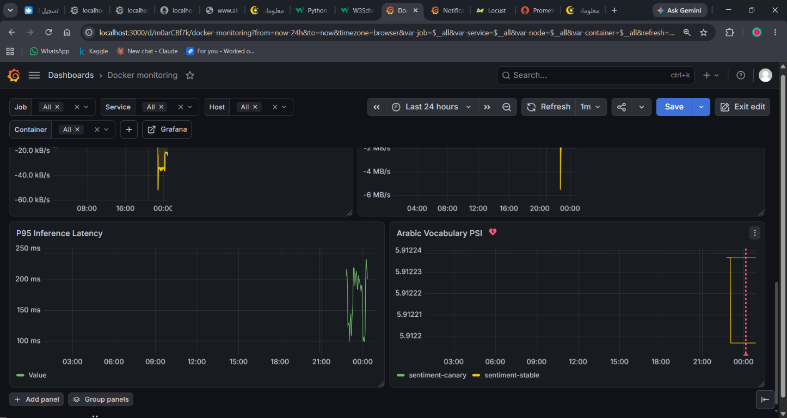

# Arabic Sentiment Analysis

An AraBERT-based project for classifying Arabic customer reviews as positive,
neutral, or negative. It includes text preprocessing, model training and
evaluation, BentoML inference services, ONNX export, an optional TensorRT
service, and monitoring for vocabulary drift.

## Features

- Arabic review preprocessing and sentiment classification
- Local Python prediction function and batchable BentoML API
- Training and evaluation artifacts tracked with MLflow
- ONNX export and optional TensorRT inference
- Vocabulary-drift monitoring with Evidently, Prometheus, and Grafana
- Stable/canary traffic routing through Nginx
- Automated tests and linting with pytest and Ruff

## Project structure

```text
.
├── .github/workflows/                 # CI workflow
├── data/
│   ├── raw/
│   └── processed/
├── models/arabert_sentiment/           # Model, tokenizer, and inference assets
├── mlruns/                             # MLflow experiments and artifacts
├── monitoring/
│   ├── grafana/
│   │   ├── dashboards/
│   │   ├── provisioning/
│   │   └── dashboard-screenshot.png
│   ├── nginx/
│   ├── prometheus/
│   └── docker-compose.yml
├── notebooks/                          # Exploration and training notebook
├── reports/                            # Benchmark and evaluation reports
├── scripts/                            # Model and reference-data utilities
├── src/arabic_sentiment_analysis/
│   ├── model.py
│   ├── predict.py
│   ├── preprocessing.py
│   ├── training.py
│   ├── service.py
│   ├── service_tensorrt.py
│   ├── export_onnx.py
│   └── vocabulary_drift.py
├── tests/
├── Dockerfile
├── bentofile.yaml
├── bentofile-tensorrt.yaml
├── locustfile.py
├── pyproject.toml
└── README.md
```

## Requirements

- Python 3.12 or newer
- [uv](https://docs.astral.sh/uv/) for dependency and environment management
- Docker with the Compose plugin to run the monitoring stack
- NVIDIA GPU and compatible CUDA/TensorRT runtime only for TensorRT inference

Install uv if needed:

```bash
pip install uv
```

Install the project and development dependencies:

```bash
uv sync --group dev
```

## Run a prediction

Use the Python prediction helper:

```bash
uv run python -c "from arabic_sentiment_analysis.predict import predict_sentiment; print(predict_sentiment('الخدمة سيئة جدًا'))"
```

The result contains the predicted label and its confidence:

```python
{"sentiment": "Negative", "confidence": 0.91}
```

The numeric confidence depends on the model output. Text is normalized before
tokenization, and inputs are truncated or padded to a maximum of 128 tokens.
Empty or invalid text returns `Neutral` with `0.0` confidence.

## Serve the BentoML API

Start the local service:

```bash
uv run bentoml serve src/arabic_sentiment_analysis/service.py --host 0.0.0.0 --port 8000
```

The batchable prediction API accepts a list of Arabic texts. For example:

```bash
curl -X POST http://localhost:8000/predict \
  -H "Content-Type: application/json" \
  -d "{\"text\": [\"الخدمة سيئة جدًا\", \"شحن سريع\"]}"
```

The service also exposes Prometheus metrics at
`http://localhost:8000/metrics`.

## Train and evaluate

The training workflow and supporting experiments are in
`notebooks/arabert-sentiment.ipynb` and
`src/arabic_sentiment_analysis/training.py`. Training and evaluation artifacts
are recorded under `mlruns/`. Refer to the notebook for the dataset preparation
and experiment workflow.

## Export to ONNX

Install the optional ONNX dependencies and export the local model:

```bash
uv sync --extra onnx
uv run arabic-sentiment-export-onnx
```

The default output is `models/arabert_sentiment/model.onnx`. To choose another
destination:

```bash
uv run arabic-sentiment-export-onnx --output path/to/model.onnx
```

## TensorRT service

The optional TensorRT Bento uses
`models/arabert_sentiment/model.fp16.engine`. Install the TensorRT dependencies
and build the Bento:

```bash
uv sync --extra tensorrt
uv run bentoml build -f bentofile-tensorrt.yaml --name arabic-sentiment-tensorrt --platform windows
```

Serve it on a machine with a compatible NVIDIA GPU, driver, CUDA, and TensorRT
runtime:

```bash
uv run bentoml serve arabic-sentiment-tensorrt:latest --host 0.0.0.0 --port 8000
```

The checked-in engine was built for Windows with TensorRT 11.4 on a GTX 1650.
TensorRT engine plans are specific to the operating system, GPU, and TensorRT
runtime. Rebuild the engine for the target environment before deploying it
elsewhere; a Windows engine cannot be served in a Linux container.

## Vocabulary-drift monitoring

The API tracks inference tokenizer tokens against the packaged reference sample
and exports the Evidently Population Stability Index (PSI) as
`arabic_sentiment_vocabulary_psi`. The metric is first calculated after 1,000
non-special tokens have been observed, then refreshed for each additional 1,000
tokens using a rolling window of up to 50,000. Unknown tokens are retained;
padding and other special tokens are excluded.

After changing the source review corpus or model tokenizer, rebuild the
reference:

```bash
uv run python scripts/build_vocabulary_reference.py
```

The generated `models/arabert_sentiment/vocabulary_reference.json` is included
in the Bento and Docker image; the raw corpus is not copied into the serving
image.

### Start the monitoring stack

From the `monitoring` directory, build and start the services:

```bash
docker compose up --build
```

The stack provides:

| Service | URL | Purpose |
| --- | --- | --- |
| Nginx router | <http://localhost:8000> | Routes API traffic to stable and canary |
| Grafana | <http://localhost:3000> | Provisioned model-drift dashboard |
| Prometheus | <http://localhost:9090> | Metrics, alert rules, and alert status |
| cAdvisor | <http://localhost:8081> | Container metrics |

Grafana's initial login is `admin` / `admin`; change the default password after
first login. The dashboard compares stable and canary PSI. PSI values are not
available until each service has observed enough inference tokens.

Prometheus evaluates `ArabicSentimentVocabularyDrift` separately for each
rollout cohort. The alert becomes active when PSI is greater than `0.25` for
one minute and can be viewed at <http://localhost:9090/alerts>. This rule raises
an alert in Prometheus; it does not send email by itself. Although the Compose
file includes Grafana SMTP settings, email delivery also requires configured
SMTP credentials and a Grafana email contact point and notification policy.
Set `SMTP_USER` and `SMTP_PASSWORD` in `monitoring/.env` if using email
notifications. Do not commit real credentials.



### Stable and canary images

For local development, Compose builds both API cohorts from the current source.
That is not a meaningful model canary: both cohorts use the same code and model.
For a real rollout, build and publish separate immutable images, then set their
references in `monitoring/.env`:

```dotenv
SENTIMENT_STABLE_IMAGE=registry.example/arabic-sentiment:stable
SENTIMENT_CANARY_IMAGE=registry.example/arabic-sentiment:candidate-2026-10-12
```

Deploy those already-built images without rebuilding:

```bash
docker compose up -d --no-build
```

The default Nginx weights send 95% of requests to stable and 5% to canary.
After reviewing prediction errors, latency, and PSI, edit the upstream weights
in `monitoring/nginx/nginx.conf` to change the traffic split, then reload Nginx:

```bash
docker compose exec nginx nginx -s reload
```

To promote or roll back, set the selected upstream to `down` and assign all
traffic to the other upstream. Keep the previous stable image available for
rollback.

## Tests and linting

Run the test suite and Ruff:

```bash
uv run pytest
uv run ruff check .
```

## License

This repository is provided for educational and research use.
